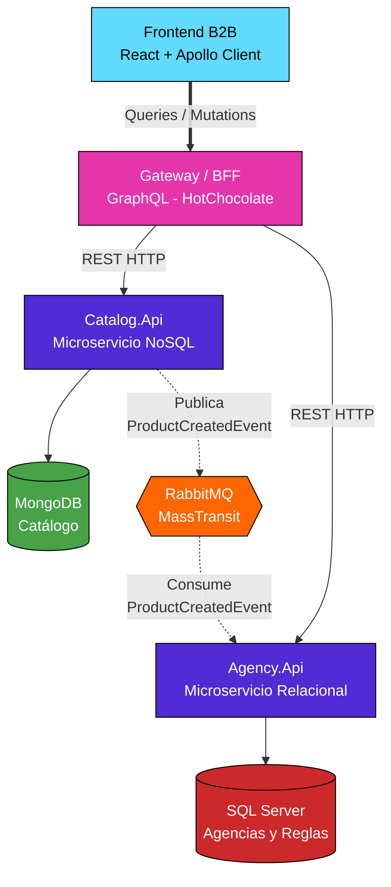

# TravelAgenciesB2B - Ecosistema de Microservicios

Plataforma distribuida orientada a eventos para la gestión de paquetes turísticos y reglas de comisiones dinámicas B2B. Orquestada completamente con **.NET Aspire**, demostrando persistencia políglota, federación de datos mediante GraphQL y comunicación asíncrona.

**Autor:** Marcelino Colón

---

## Arquitectura del Sistema

El ecosistema está dividido en microservicios independientes, desacoplados mediante un Message Broker y unificados para el cliente a través de un patrón *Backend for Frontend (BFF)*.



## Tecnologías Core

* **Orquestador:** .NET Aspire (Gestión de contenedores y Service Discovery)
* **API Gateway:** GraphQL (HotChocolate)
* **Backend:** ASP.NET Core Web API (C#)
* **Mensajería:** RabbitMQ gestionado con MassTransit
* **Bases de Datos:** MongoDB (Catálogo) y SQL Server (Reglas B2B usando Dapper/EF)
* **Frontend:** React, TypeScript, Apollo Client, React Hook Form, React Router DOM

---

## Características y Fases de Implementación

### Fase 1: Persistencia Políglota y BFF
* Modelado de documentos complejos en **MongoDB** para paquetes turísticos.
* Almacenamiento relacional de agencias y porcentajes de descuento B2B dinámicos en **SQL Server**.
* Configuración de resolvers de **GraphQL** para cruzar orígenes de datos, calculando precios con descuento en tiempo real sin acoplar las bases de datos.

### Fase 2: Panel B2B (Full Stack)
* Integración del cliente **React** aislado en dos módulos principales (`/` para catálogo B2B, `/admin` para gestión).
* Envío de mutaciones GraphQL estructuradas con tipos `Input`.
* Blindaje defensivo de la UI implementando políticas `cache-and-network` de Apollo Client para prevenir desincronizaciones del DOM tras escrituras.

### Fase 3: Arquitectura Orientada a Eventos
* Eliminación de llamadas HTTP directas entre microservicios para notificaciones.
* Despliegue de **RabbitMQ** vía .NET Aspire.
* Publicación del contrato `ProductCreatedEvent` desde `Catalog.Api` tras guardar en MongoDB.
* Consumo asíncrono pasivo en `Agency.Api` procesado mediante **MassTransit**.

---

## Cómo Ejecutar el Proyecto

### Requisitos Previos
* Visual Studio 2026 (o superior).
* .NET 8.0 SDK (o superior).
* Docker Desktop (En ejecución para hospedar MongoDB, SQL Server y RabbitMQ).
* Node.js (Para el cliente React).

### Inicialización
1. **Clonar el repositorio:**
   ```bash
   git clone <url-del-repositorio>
   cd PracticaAspire
   ```

2. **Levantar el Backend Distribuido:**
   * Abre la solución `PracticaAspire.sln` en Visual Studio.
   * Selecciona el proyecto **`AppHost`** como proyecto de inicio.
   * Presiona `F5`. .NET Aspire descargará las imágenes de Docker automáticamente y levantará las bases de datos, RabbitMQ, el BFF y los microservicios.

3. **Levantar el Frontend:**
   * Abre una terminal en la carpeta `react-client`.
   * Instala las dependencias y corre el servidor de desarrollo:
     ```bash
     npm install
     npm run dev
     ```

## Endpoints Clave
* **Dashboard .NET Aspire:** (Puerto dinámico asignado por VS - revisar consola)
* **GraphQL Banana Cake Pop:** `https://localhost:7165/graphql`
* **React Client:** `http://localhost:5173`
